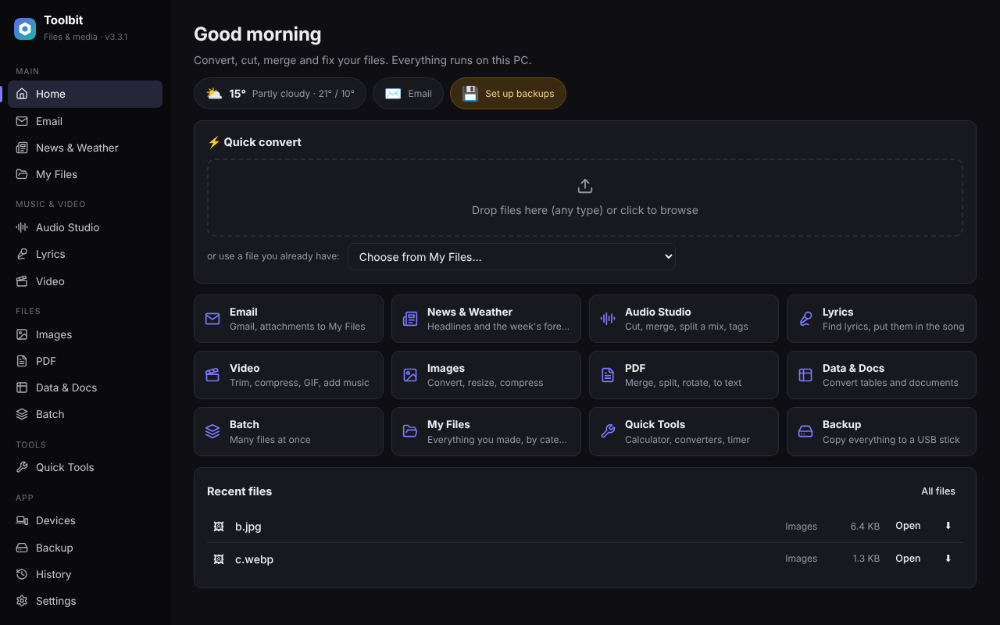
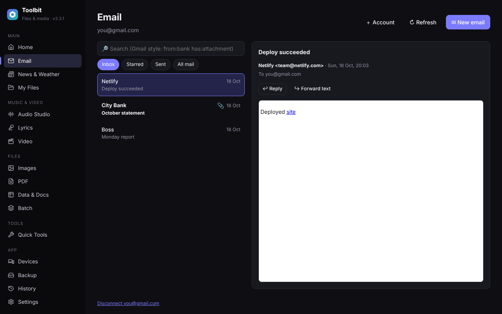
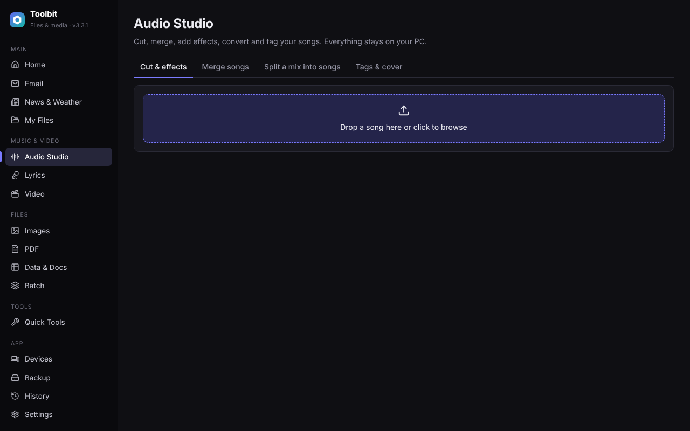
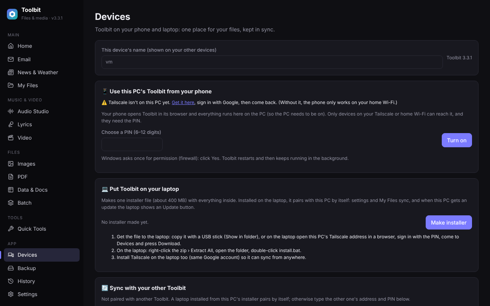
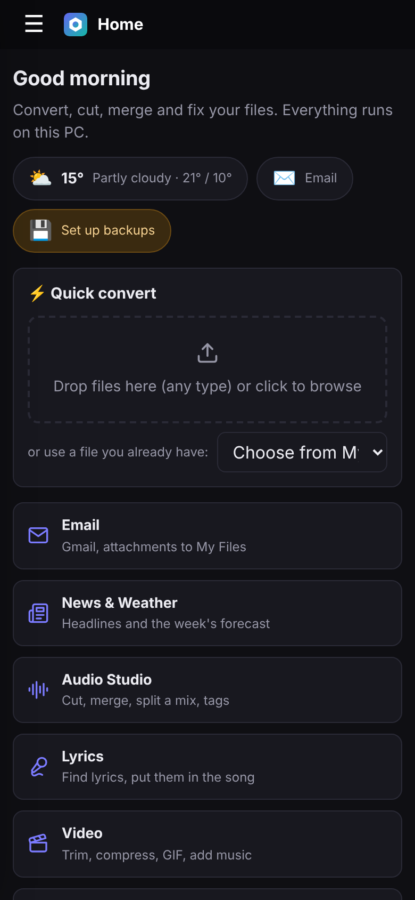

# Toolbit

One app for the everyday file jobs you'd normally google: convert, cut, merge, compress and fix files, plus Gmail, news and weather. No more online converters with paywalls, watermarks, upload limits or "sign up with Google" pop-ups. Everything runs on your own Windows PC, with no cloud service and no account, and you can use it from your phone and laptop too.

## Why

Small tasks like turning a PDF into Word, shrinking a video for email, splitting a DJ mix into songs or converting a CSV to Excel usually mean searching for a website, uploading private files to it, and hitting a paywall or a sign-up wall halfway through. Toolbit puts all of those tools in one place that works offline and keeps your files on your own machine.



## Features

- **Quick convert**: drop any files on Home and pick a target format in one click (images, audio, video, PDF, documents, tables).
- **Audio Studio**: cut and trim on a waveform, merge, normalize loudness, edit tags, and split a long mix into songs (from a tracklist with timestamps, or automatically).
- **Video**: convert, compress, trim, make GIFs, extract audio (ffmpeg).
- **Images and PDF**: convert, resize, compress, merge, split, rotate, password-protect, PDF to Word or text, images to one PDF.
- **Data and Docs**: CSV / Excel / JSON / Parquet / Markdown conversion and previews.
- **Batch**: run one action over many files as a background job with progress (convert, compress, rename with patterns, ZIP).
- **Email**: several Gmail accounts over IMAP/SMTP with app passwords. Search with Gmail syntax, read sanitized HTML, save attachments to My Files, send files.
- **News and Weather**: your own RSS/Atom feeds and a 7-day forecast (Open-Meteo, no key needed).
- **Quick Tools**: calculator, unit and currency converters, focus timer, QR codes, passwords and more.
- **USB backup**: database and settings snapshots (passwords excluded), with checks that refuse cloud-synced drives.
- **Other devices**:
  - **Phone**: use the PC's Toolbit from a phone browser over Tailscale or home Wi-Fi, behind a PIN, with a phone layout.
  - **Laptop**: a one-file installer that pairs with the PC by itself. Settings and files sync both ways, and the laptop shows an Update button whenever the PC runs a newer version.

| Email | Audio Studio | Devices |
|---|---|---|
|  |  |  |



## How it works

```
Edge/Chrome --app window  ──HTTP──▶  FastAPI (Python 3.12, uvicorn)  ──▶  SQLite + files on disk
Phone browser (Tailscale) ──PIN────▶        │                              ffmpeg, Pillow, pypdf, pandas…
Laptop Toolbit ──peer token───────▶   /api/peer/*  (sync, updates)
```

- **Backend:** FastAPI routers per tool (`app/server/routers`), shared helpers in `app/server/core` (file registry, jobs, media, errors). Heavy libraries load on first use, so the app starts in about a second.
- **Frontend:** a React single-page app, bundled with esbuild into one JS file, served by the backend, and opened as an app window. Light and dark themes, hash routing.
- **Launcher** (`app/launcher.py`):
  - Single-instance check.
  - Shows a splash screen right away.
  - Keeps running in the background when the window closes.
  - Restarts itself in one click after an update.
- **Long tasks** (batch, sync, installer) run as background jobs that the UI polls for progress.
- **Errors** reach the user as one plain sentence (`core/errors.py`). The full traceback goes to the log.

### Sync and updates (`app/server/routers/devices.py`)

- **Pairing:** with the PIN or through the installer's one-time `pairing.json`. Tokens are stored only as SHA-256 hashes.
- **Settings:** last change wins, per key.
- **Files:** compared by content hash (SHA-1) in both directions. Deletions travel as tombstones and un-list the file on the other device.
- **Updates:** the laptop downloads the PC's app bundle, backs up the files it replaces, never writes outside the app folder, and restarts.

### Security for remote access

- Off by default. When it's on, only private and Tailscale addresses are accepted, and every non-local request needs a PIN session (PBKDF2 hash, HttpOnly cookie, 90-day expiry).
- PIN attempts are counted under a lock (per address and overall), so parallel guessing doesn't get extra tries.
- A Host header allow-list blocks DNS rebinding, and a same-origin check blocks cross-site POSTs.
- Peer endpoints need a token, even from localhost.
- Phone sessions can't use PC-only actions (open files on the desktop, change settings, restart).
- Device sync and updates only travel over Tailscale (encrypted). Gmail app passwords are never sent over plain Wi-Fi.
- One UAC prompt adds a Windows Firewall rule limited to Tailscale and the local subnet.

## Running it from source

```bash
pip install -r requirements.txt
python app/launcher.py
```

Frontend (only needed if you change `app/frontend-src/app.js`):

```bash
cd app/frontend-src
npm i esbuild qrcode-generator
npx esbuild app.js --bundle --minify --format=esm --target=es2020 --outfile=../web/assets/index-vXXX.js
cat orig.css extra.css > ../web/assets/index-vXXX.css   # then point web/index.html at the new names
```

Data lives in `%APPDATA%\DataAssistant` (settings.json, assistant.db, logs). Results go to `Documents\Toolbit`.

## Project structure

```
app/
  launcher.py            start-up, window, background mode, restart
  server/main.py         app factory, routers, middleware
  server/core/           config, db, file registry, jobs, media, errors, history
  server/routers/        one module per tool (audio, video, image, pdf, data, mail, news, devices…)
  web/                   built frontend, icons, splash screen
  frontend-src/          frontend source (app.js, css)
```

## History

The project started as a "Data Assistant" with an AI chat and planner (Claude API). From version 3.0 it became a focused, AI-free files-and-media toolbox, and version 3.3 added the phone and laptop features. See [CHANGELOG.md](CHANGELOG.md).

Built by Kristian Lala, with help from Claude (Anthropic).

## License

MIT
